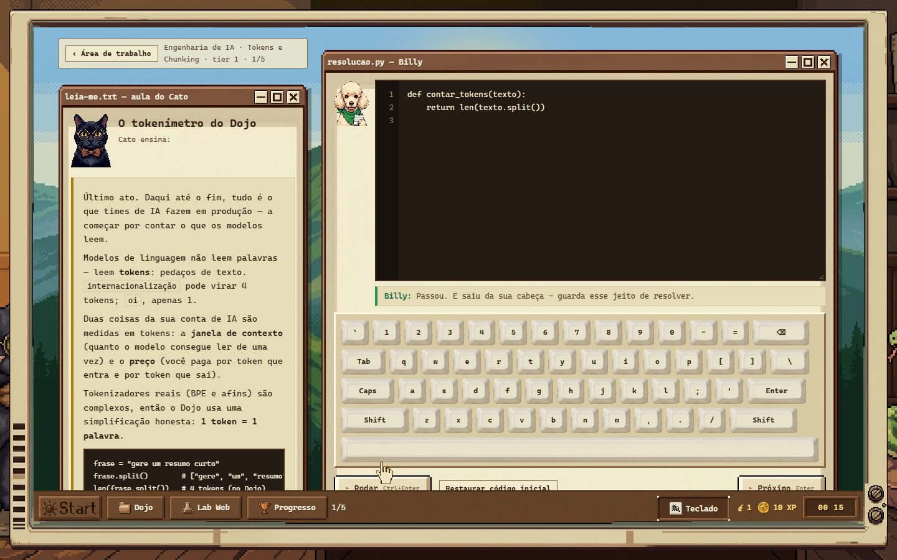
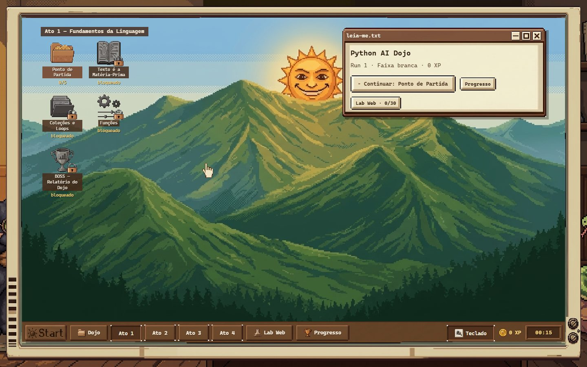

# Python AI Dojo

A browser game that teaches **the Python an AI engineer writes every day**: token and cost
math, calling LLM APIs, tool calling, structured output, chunking, embeddings, retrieval,
retries, and data handling. Every exercise runs **real Python in your browser** (Pyodide).
There's no account, no backend and no telemetry; progress stays in your browser.

**▶ Play it: [python-ai-dojo.vercel.app](https://python-ai-dojo.vercel.app)** (desktop browser, keyboard recommended)

## Languages

The game is available in **English** and **Brazilian Portuguese**. Both languages carry the
full game: the interface, the tutors' lines, the glossary, all 273 Python exercises, the
5 bosses and the 30 Web Lab exercises, with their tests and mock APIs.

On first visit the game picks the language from your browser (`pt*` → Portuguese, anything
else → English). To switch:

- **In the game:** the **Português / English** buttons on the welcome window, or **Settings → Language**.
  The page reloads in the new language and your progress is kept, because exercise ids are
  the same in both languages.
- **By link:** add `?lang=en` or `?lang=pt` to the URL, for example
  `https://python-ai-dojo.vercel.app/?lang=en`.

Translator notes and the parity contract between the two content folders are in
[`docs/I18N.md`](docs/I18N.md).



## Why I built it

Most Python courses stop at syntax. The daily work of an AI engineer is different: count
tokens before you hit the context window, parse a broken tool-call JSON, retry with backoff
without hammering the API, chunk a document with overlap, rank by cosine similarity. I
wanted a place to practice exactly that, with instant feedback and without paying for API
calls. So every "API" in the game is a deterministic mock that behaves like the real thing.

## What's inside

| Feature | Details |
|---|---|
| **273 Python exercises** | 4 acts (language fundamentals → data, text and robustness → APIs and numbers → AI engineering) + 5 multi-stage bosses, each in 3 difficulty tiers |
| **30 Web Lab exercises** | HTML/CSS/JS with a live preview: fix the back end, fix the front end, build the UI, wire front ↔ back |
| **Act 4: AI engineering** | tokens and context budgets, cost per call from `usage`, system prompts, multi-turn memory, OpenAI- and Anthropic-style chat APIs, OpenAI-style tool calling (including repairing broken tool-call JSON), structured JSON output, chunking, embeddings and semantic search, RAG context assembly |
| **Learning mechanics** | tiered hints with an XP cost, Leitner spaced review driven by your own progress, per-concept mastery stars, and belts from white to black |



## How it works

```
index.html + js/          single-page app, no framework
 ├─ engine.js             game rules: XP, streaks, belts, Leitner review
 ├─ pybridge.js  ──────►  pyworker.js (Web Worker running Pyodide 0.27.7 / CPython 3.12.7)
 │                         └─ py/runner.py + py/mocks_ia.py  (the same files the offline verifier runs)
 ├─ webrunner.js          Web Lab: runs DOM assertions inside a sandboxed iframe (postMessage)
 └─ storage.js            localStorage with schema migration, export/import
content/*.json            exercise bank (Portuguese): statement, starter, reference solution, visible + hidden tests
content/en/*.json         the same bank in English (same ids, same tests, English mock contract)
js/i18n.js                interface text in both languages; py/runner.py + mocks take lang="pt"|"en"
```

- **Same runner everywhere.** `py/runner.py` and `py/mocks_ia.py` are the single source of
  truth. The browser worker and the offline verifier execute the same files, and the parity
  check below proves the results match.
- **Deterministic AI mocks.** `requests` is served from a fixed route table (the fake host
  `api.dojo.dev` is never contacted). OpenAI- and Anthropic-style clients record every call
  for assertions. Embeddings are hashed bag-of-words vectors (16 dims, unit norm). A
  **virtual clock** makes `time.sleep` / `asyncio.sleep` advance instantly, so retry and
  backoff code is testable in microseconds.
- **Infinite loops don't freeze the tab.** Execution has a 2-stage timeout: first a SIGINT
  through a `SharedArrayBuffer` (when the page is cross-origin isolated, via the COOP/COEP
  headers in `vercel.json`), then terminate and respawn the worker.
- **asyncio inside Pyodide.** Pyodide already runs an event loop (WebLoop), so the runner
  temporarily neutralises the running loop while it drives test coroutines. Without that,
  async exercises passed in CPython and failed in the browser. Browser QA caught it, and the Pyodide parity check below now guards it.

## Verification

Every exercise is checked automatically: the **reference solution must pass** all visible
and hidden tests, and the **starter code must fail** (so no exercise can be solved by doing
nothing).

| Check | Command | Result at publish time |
|---|---|---|
| Schema, content rules, solution passes, starter fails (CPython 3.12) | `python -X utf8 tools/verify.py --lang pt` / `--lang en` | **273/273** in each language |
| The same check inside real Pyodide in Chrome | `DOJO_LANG=pt npm run parity` / `DOJO_LANG=en npm run parity` | **273/273** in each language |
| Web Lab: solution passes, starter fails (real browser) | `DOJO_LANG=pt npm run weblab` / `DOJO_LANG=en npm run weblab` | **30/30** in each language |
| Same two browser checks against the live deploy | `DOJO_URL=https://python-ai-dojo.vercel.app npm run parity` | **273/273** and **30/30** |
| Markdown rendering of every statement, both languages | `npm run md` | **0 broken fields** |
| English content mirrors the Portuguese structure; no Portuguese left in it | `python -X utf8 tools/i18n_check.py --estrito` | **0 structural diffs, 0 leftovers** |

```bash
# offline verifier (Python 3.12, pinned to Pyodide's numpy/pandas)
python3.12 -m venv .venv-verify        # Windows: py -3.12 -m venv .venv-verify (the numpy/pandas pins need 3.12)
.venv-verify/Scripts/python -m pip install -r tools/requirements-verify.txt   # Windows path; use bin/ on macOS/Linux
.venv-verify/Scripts/python -X utf8 tools/verify.py

# browser checks (needs Chrome installed and the game served on :8321)
python -X utf8 tools/serve.py --sem-navegador &
npm install
npm run parity && npm run weblab
```

## Run it locally

You need Python 3.12+ and an internet connection on the first load (Pyodide comes from the jsDelivr CDN and is then cached by the browser).

- **Windows:** double-click `run.bat`.
- **Any OS:** run `python -X utf8 tools/serve.py`.

Either way, the game opens at `http://localhost:8321`. A local server is required because
Web Workers don't run from `file://`. Deploying is just static hosting; see `DEPLOY.md`.

## How it was built

I designed the game, the rules and the architecture. I wrote the runner, the mocks and the
verification harness with an AI coding agent (Claude Code) as a pair. The exercise bank was
drafted by AI agents, one per level, into separate fragments. Each fragment had to pass
`tools/verify_fragment.py` before it was merged (authoring rules in
`tools/GUIA-AUTOR.md`). Nothing ships unless the harness is 100% green. The pixel art (the
desktop, the windows, and the tutors Cato and Billy) was generated with Google Gemini and
sliced into sprites.

## Security model

Everything runs in the visitor's browser; there is no backend and no account. The things
that could carry someone else's code are a save file you import and the Web Lab page code,
so they are treated as untrusted:

- **Saves are normalised.** Imported files and whatever is already in `localStorage` go
  through a whitelist with type coercion (`normalizarSave` in `js/storage.js`): numbers must
  be finite, strings are length-capped, unknown keys are dropped, and stored Web Lab code is
  kept only as truncated `html`/`css`/`js` strings. Every save-derived value is escaped again
  before it reaches `innerHTML`.
- **Web Lab code runs in an opaque origin.** The preview and test iframes use
  `sandbox="allow-scripts allow-forms"` without `allow-same-origin`, so page code cannot read
  the game's DOM or storage. The test harness is injected into the iframe and talks to the
  game only through `postMessage` (`ready` → `run` → `result`), and both sides check
  `event.source`. The iframe document also carries its own CSP that blocks network access.
- **Deploy headers.** `vercel.json` sets a Content-Security-Policy (scripts only from the site
  and the pinned Pyodide path on jsDelivr, `wasm-unsafe-eval` for WebAssembly, no framing),
  plus `X-Frame-Options: DENY`, `nosniff`, a strict referrer policy and a minimal
  permissions policy, next to the COOP/COEP headers. `tools/serve.py` reads the same header
  list from `vercel.json`, so local play sees exactly the production policy.

The CSP still allows `'unsafe-inline'` and `'unsafe-eval'` for scripts: the import map is
inline, and the sandboxed Web Lab iframes (which inherit the page policy) run the student's
inline scripts and the test harness.

## Known limitations

- The first load needs the internet, because Pyodide comes from a CDN.
- It's designed for desktop with a keyboard. It opens on mobile, but it isn't comfortable.

## License

Code, exercise content and art: MIT (see `LICENSE`). Vendored libraries keep their own
licenses: GSAP and plugins (GSAP Standard "No Charge" License) and Lenis (MIT), in `js/vendor/`.

---

### Em português

O jogo tem versão completa em **português** e em **inglês**. Para trocar, use os botões
**Português / English** na janela de boas-vindas, **Configurações → Idioma**, ou acrescente `?lang=pt` ao
endereço.

O **Python AI Dojo** é um jogo no navegador para aprender o Python do dia a dia de quem
trabalha com IA: tokens, custo, APIs de LLM, tool calling, saída estruturada, chunking,
embeddings e RAG. São 273 exercícios com Python de verdade rodando no navegador, mais 30
exercícios de HTML/CSS/JS, tudo verificado automaticamente.

Para jogar: dê duplo clique em `run.bat` (Windows) ou rode `python -X utf8 tools/serve.py`, e
abra `http://localhost:8321`.
